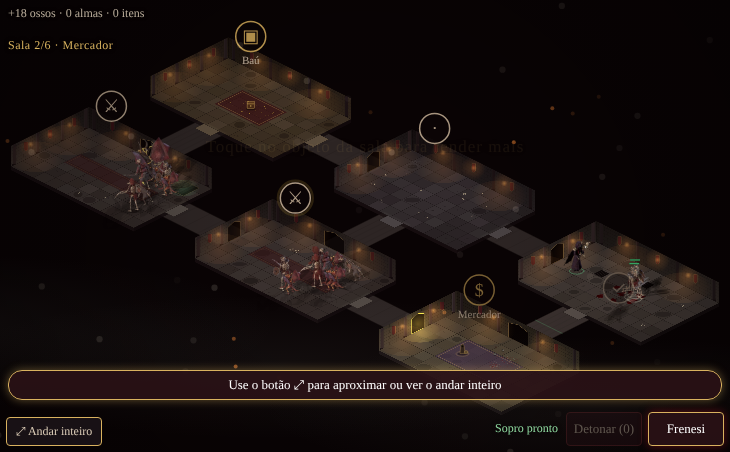
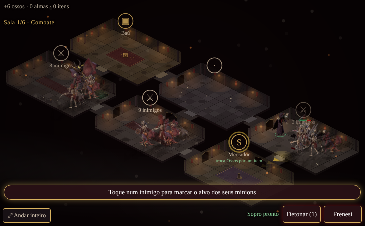
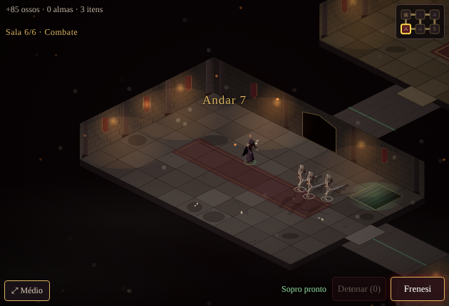
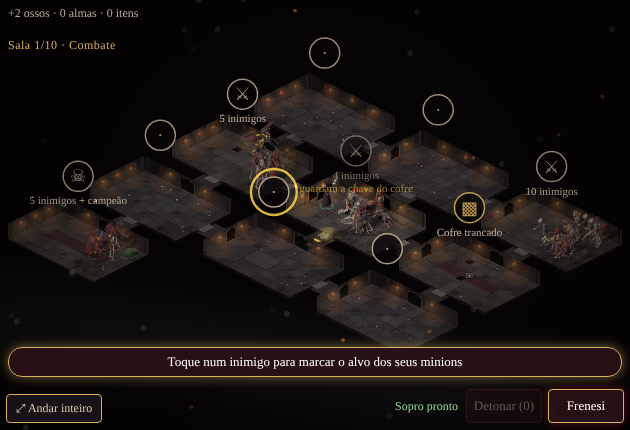
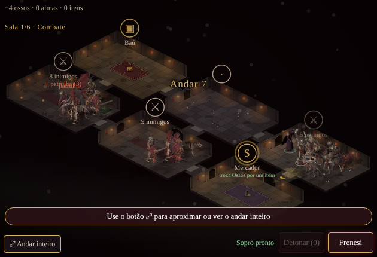

# Necromante Idle

Idle game sombrio, na linha de Diablo: um necromante desce sozinho uma abadia afundada, ceifa as almas dos inimigos,
ergue-as como minions e as evolui. Combate automático e visual, com gore; o jogador presente rende mais que o ausente.



**Jogar no navegador:** a pasta `docs/` é o jogo pronto. Para publicar com GitHub Pages: Settings → Pages → branch `main`, pasta `/docs`.

## O que há aqui

| Pasta | Conteúdo |
|---|---|
| `jogo/Nucleo` | Regras do jogo em C# puro (.NET Standard 2.1), determinístico, 10 ticks/s. Sem Unity. |
| `jogo/Testes` | Testes (104) e o portão de balanceamento: um robô joga campanhas inteiras e mede 9 metas. |
| `jogo/Web` | Versão de navegador: o núcleo compilado para WebAssembly + cliente em canvas. `./montar.sh` gera o site. |
| `jogo/UnityProjeto` | Projeto Unity 6.3 LTS (camada visual). Conferido só por compilação; ainda não aberto numa Unity. |
| `jogo/Replay` | Exporta um replay da simulação para as prévias em vídeo. |
| `pipeline` | Fábrica de monstros em Blender (Python): modelos procedurais → sprites isométricos em 8 direções. |
| `docs` | Build web publicado. |

## Sistemas já no jogo

Combate automático com feitiços · ceifa de almas (automática ou por toque, com bônus) · poderes de toque (Detonar, Frenesi) ·
exército com Comando, níveis e estágios · fusão de almas · bestiário com Domínio por espécie · equipamento (9 espaços,
5 raridades, lendários) · Necrópole (5 construções) · missões com história · encruzilhadas com pactos · save local e
progresso ausente.

Masmorra explorada sala por sala, em vista isométrica: cada andar é um mapa sorteado (combates, baús, santuários, fontes,
almas presas, emboscadas, mercador, altar de sangue, câmaras vazias), sala do chefe com ambiente (lava, névoa, geada) e um
nível secreto raro. Também: talentos, sacrifício e Fragmentos, oferendas e ritos, Ascensão com Legados, feitiços de item com
modo automático, dons aleatórios, presságios, Sorte, estatísticas de combate e painel de testes.

Cada espécie erguida como minion tem uma habilidade passiva própria: Esqueleto (Aparar), Zumbi (Miasma), Cão de Cripta
(Sede), Arqueiro Ossudo (Olho Morto), Diabrete (Matilha), Acólito Caído (Agouro), Carniçal (Banquete), Diabo de Guerra
(Fúria de Guerra), Aparição (Incorpórea), Colosso de Ossos (Baluarte) e Rês Profana (Investida). Elas aparecem na ficha
do minion, na lista do exército e no Bestiário.

Salas mais novas: Forja de Ossos (couraça de ossos para o grupo, visível como uma faixa clara sobre a barra de vida) e
Ninho (toque para esmagar os ovos e levar Ossos; se ninguém tocar, as crias chocam e a sala vira luta). Dois conjuntos
Profanos de três peças (Vestes do Coveiro, Garras do Carniceiro), com painel de bônus na ficha do item.

## Rodar

```bash
# testes e portão de balanceamento (9 metas; sai com erro se alguma ficar fora da faixa)
cd jogo && dotnet run -c Release --project Testes -- --so-testes
cd jogo && dotnet run -c Release --project Testes -- --metas 24 14

# versão de navegador (precisa de: dotnet workload install wasm-tools)
cd jogo/Web && ./montar.sh && python3 -m http.server -d dist
```

O histórico de decisões está em `jogo/PLANO_CICLOS.md`; as metas medidas, em `jogo/METAS_BALANCEAMENTO.md`.
Toda a arte é própria, gerada pelo pipeline deste repositório.

## Como é jogar

Cada andar é uma masmorra sorteada, em bloco, inteira à vista. O grupo caminha pelos corredores de sala em sala; os inimigos
de cada sala já estão lá, à espera. Tocar no símbolo de uma sala muda a rota (por exemplo, para pegar a chave antes do cofre).








