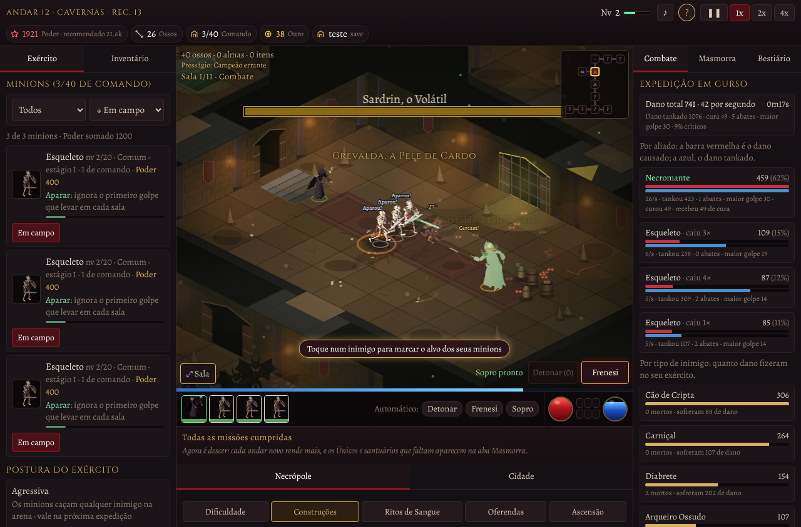
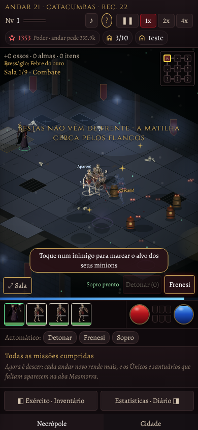
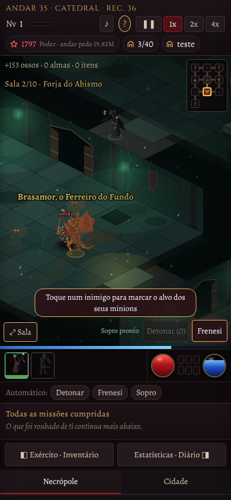
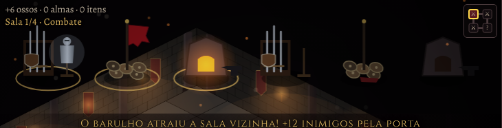

# Necromante Idle

Um jogo *idle* sombrio com o clima do Diablo 1. Você é um necromante: o seu exército de mortos desce sozinho uma abadia
afundada, sala por sala, andar por andar. Você assiste e dá os toques que fazem diferença: marcar o alvo, ceifar uma alma
na hora, interromper o golpe de um chefe. Entre as descidas, gasta Ossos e Essência para crescer. O jogo continua
enquanto você está fora.

 

## Como jogar

1. Abra o jogo e toque em **Começar**: o exército desce sozinho.
2. Na luta, toque num inimigo para marcar o alvo, no orbe verde para ceifar a alma e no retrato de um aliado para curá-lo.
3. Entre as descidas, gaste Ossos e Essência no **Exército** e na **Necrópole**; os cartões de porta e santuário pedem um toque para decidir.

**Onde jogar:**
- O link do jogo no Claude só abre para quem o dono compartilhar.
- Link público: a pasta [`docs/`](docs) é o jogo pronto (C# compilado para WebAssembly, sem instalar nada). Ele aparece
  assim que o dono ligar o GitHub Pages: *Settings → Pages → branch `main`, pasta `/docs`*.
- Funciona no celular e no computador. O progresso fica salvo no próprio navegador e o jogo continua enquanto você está fora.

## O que tem

- **4 Atos, 40 andares** (Catedral, Catacumbas, Cavernas e Fornalha), cada andar um mapa sorteado e explorado sala por
  sala, com raio de luz: fora dele, só os olhos dos monstros brilham no escuro.
- **3 dificuldades** (Normal, Pesadelo e Inferno), com resistências e imunidades crescentes.
- **Missões de cenário** sorteadas por jogo: a porta do carniceiro, a tumba do rei, a fonte envenenada, a câmara de ossos,
  os salões dos cegos, a Fortaleza Rubra, o Poço dos Lamentos, o Relicário Profanado, a Forja do Abismo e o Canil Maldito. Missão pronta é resgatada sozinha se você
  esquecer.
- **Monstros únicos** com nome e séquito, alguns com habilidade própria (como Grevalda, a Pele de Cardo, que devolve parte
  de cada golpe, ou Vorasta, a Carne que Volta, que regenera), e Campeões que surgem no meio do andar.
- **Presságios** que mudam as regras de um andar (Horda, Chuva de cinzas, Febre do ouro, Noite sem lua...) e **11 santuários** com efeito
  a descobrir. Nos primeiros andares, o **Ossário esquecido** levanta um esqueleto que luta pelo grupo e o **Altar de velas** chama almas.
- **Feitiços por livro**, como no Diablo: 12 feitiços (Golem, Muralha de Fogo, Relâmpago em Cadeia, Pedra
  Maldita, Espírito de Ossos, Lamento de Ossos...), cada leitura sobe um nível.
- **Exército de almas**: 18 espécies erguíveis, cada uma com uma habilidade própria (o Arauto ergue escudos, o Sineiro atordoa, a
  Carpideira cura, o Lacaio explode); níveis, qualidades, fusões e Bestiário.
- **Itens** com 5 raridades, Lendários, 17 Únicos com efeito próprio, 4 conjuntos (como os Véus do Cortejo Fúnebre, que prolongam os mortos
  temporários), durabilidade, identificação, armadilhas
  em sarcófagos e urnas, e uma cidade (Ferreiro, Curandeira, Bruxa, Ancião).
- **Ascensão** com uma árvore de 5 ramos para as vidas seguintes.

## O que é original e o que é referência

Toda a arte, os monstros desenhados, os textos, os sons e o código são deste projeto. O Diablo 1 serve de referência de
**regras e números** (curvas de vida, resistências por família, tamanho relativo dos monstros), tirados de tabelas
públicas; nenhum arquivo, arte, som ou texto da Blizzard está neste repositório. Alguns chefes ainda usam nomes do jogo
original e podem ser trocados.

Fontes: [Cinzel](https://github.com/NDISCOVER/Cinzel) e [Alegreya](https://github.com/huertatipografica/Alegreya),
ambas sob a SIL Open Font License (licenças em `docs/fontes/`).

## Pastas

| Pasta | Conteúdo |
|---|---|
| `jogo/Nucleo` | Regras do jogo em C# puro, determinístico, 10 ticks por segundo. |
| `jogo/Testes` | 173 testes e o portão de balanceamento: um robô joga campanhas inteiras e confere 9 metas de tempo. |
| `jogo/Web` | Versão de navegador (WebAssembly + canvas). `./montar.sh` gera o site em `Web/dist`. |
| `jogo/UnityProjeto` | Projeto Unity 6.3 com o mesmo núcleo (camada visual em andamento). |
| `pipeline` | Fábrica de monstros em Blender (Python): modelos procedurais viram sprites isométricos em 8 direções. |
| `docs` | O jogo de navegador pronto. |
| `imagens` | Capturas de tela usadas no plano de desenvolvimento. |

O histórico de cada mudança, com as medições de balanceamento, está em `jogo/PLANO_CICLOS.md`.
